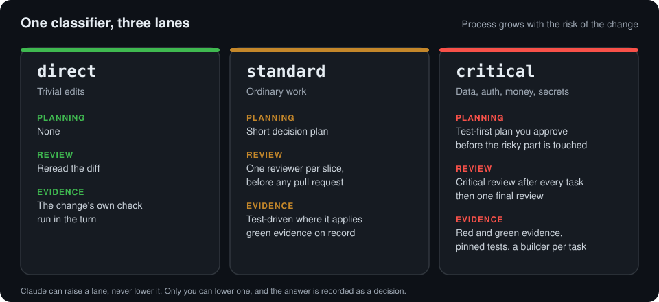
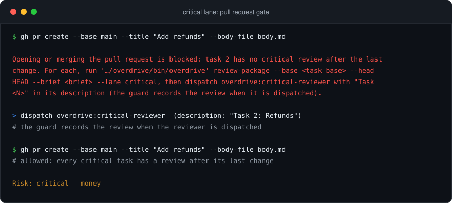
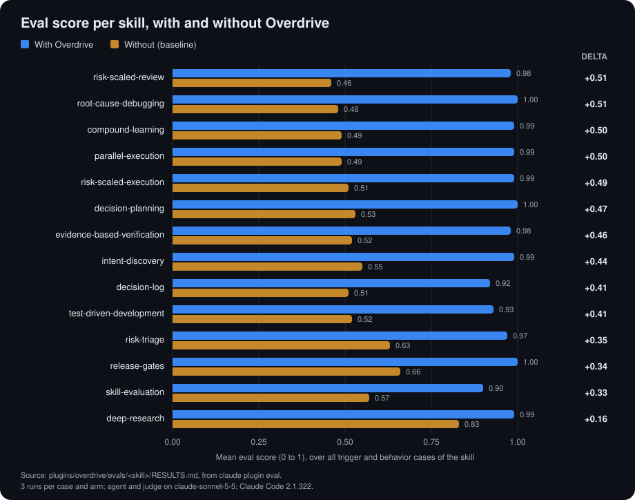

<div align="center">

<picture>
  <source media="(prefers-color-scheme: dark)" srcset="assets/logo-dark.svg">
  
</picture>

**Process that scales with risk.** A Claude Code plugin that gives every change only the planning, review and evidence it needs.

[](https://github.com/DavidZapataOh/overdrive/actions/workflows/ci.yml)
[](LICENSE)
[](CHANGELOG.md)
[](#skills)

</div>

## Why

Coding agents tend to fail in one of two directions: they run a full ceremony over a typo fix, or they merge a billing change after a glance. Both come from treating every change the same.

- **Risk decides the process, not size.** A deterministic classifier reads the paths, the diff and the request, and puts each change in `direct`, `standard` or `critical`.
- **Small stays fast.** A trivial edit gets no plan and no review, only its own check.
- **Risky is never under-reviewed.** Data, auth, money, secrets and public contracts get a test-first plan you approve, a review after every task, and a hook that blocks the pull request until the reviews exist.
- **Claude can raise a lane, never lower it.** Only you can lower one, and the answer is recorded as a decision.

<p align="center"></p>

## Install

```sh
claude plugin marketplace add DavidZapataOh/overdrive
claude plugin install overdrive@overdrive
```

Start a new Claude Code session and the plugin loads. It is the same on macOS, Linux and Windows. Nothing runs outside Claude Code, and the runtime needs only Bash 3.2, git and the POSIX tools that ship with them.

If the marketplace clone fails over SSH, set `CLAUDE_CODE_PLUGIN_PREFER_HTTPS=1` in that terminal and run the first command again.

The plugin is 14 skills, 5 subagents, three hooks (session router, tool-call guard, stop check) and a small shell CLI, `overdrive`.

## See it work

In the critical lane the guard refuses to open or merge a pull request while a task has no critical review after its last change. The review is recorded when the reviewer is dispatched, and the reply ends with the lane the change was handled in.

<p align="center"></p>

## How the lanes work

| Lane | Planning | Review | Evidence |
| --- | --- | --- | --- |
| `direct` | none; test first if testable | none; reread the diff and run the change's own check | the change's own test or command, run in the turn |
| `standard` | short decision plan with `### Task N:` headings | one `overdrive:reviewer` per slice, before any pull request | test-driven where it applies; `overdrive evidence green` before the slice package |
| `critical` | full test-first plan that the user approves before the critical part is touched | `overdrive:critical-reviewer` after every task and after every change to it, then one `overdrive:final-reviewer` on the slice | pinned tests, red and green evidence, hard-case list, non-regression check; each task built by a separate `overdrive:builder` |

The classifier (`overdrive risk`) picks the lane from facts, not from size. It reads the paths a change touches, the lines it adds and removes, and, before any edit, the words of the request. Built-in floors put a change in `critical` for irreversible data and migrations, auth, tenant isolation, money, secrets, CI and delivery, public contracts, concurrency, a changed risk map, a removed or skipped test, a text file git shows as binary and a source file that no test covers. Dependency and test-configuration changes, deleted files and files made executable put it in `standard`. A change that raises nothing is `direct`.

Claude may raise a lane when it sees risk the classifier cannot, and it never lowers one. A failed classification is `critical`. Only the user can lower a lane, by answering the stated risk, and the answer is recorded as a decision. Signals, floors and the steps of each lane are in [docs/lanes.md](docs/lanes.md).

## First run

When a session starts (or is cleared or compacted), the SessionStart hook injects the router: a short text that tells Claude to classify every repository change before its first edit, which skill to load for which situation, and to end each change with a Risk line. Questions and explanations stay read-only and are not classified.

The first time a repository without `.overdrive/risk-map.conf` is classified, the classifier adds the note `risk-map missing; propose one with overdrive:risk-triage`. Claude then reads the repository and proposes a project risk map: the floor areas as the project names them (a billing module with an unusual name, a domain word in the team's language, an internal API other services use). You approve or edit it, and it is committed like any other change; until then the built-in floors alone decide. The proposal is made once. See [docs/risk-map.md](docs/risk-map.md).

Every reply that changes a repository ends with the classifier's line:

```
Risk: critical — money, dependencies
```

The word after `Risk:` is the lane the change was handled in; the items after the dash are what raised it, critical items first, or `none`. If the user lowered the lane, the line keeps the items and says so: `Risk: direct — data-migration (lowered by user, D-0007)`. The Stop hook checks the line against a fresh classification of the working tree and the branch's commits, and blocks one that states less than the classifier finds unless it cites an active decision in which the user lowered the lane.

## Skills

Automatic skills are loaded by Claude when the situation matches their description; the router also names several of them. User-invoked skills (`disable-model-invocation`) run only when you start them with `/overdrive:<name>`.

| Situation | Skill | Invocation | What it does |
| --- | --- | --- | --- |
| Any change above `direct`, a missing risk map, a request to raise or lower a lane | `risk-triage` | automatic | Classifies before the first edit and again on the diff, raises lanes the classifier cannot see, asks the user before any lowering, proposes the project risk map. |
| A new feature or product idea whose why or shape is open | `intent-discovery` | automatic | Asks one question at a time, only what the user alone can decide, in plain language, and ends in a one-page skeleton. |
| Planning, scoping, breaking work down | `decision-planning` | automatic | Writes the plan at the depth of the lane; for multi-slice work a skeleton first, then only the next slice. |
| Executing, continuing or resuming a written plan | `risk-scaled-execution` | automatic | Runs the plan task by task with a ledger, classifies each task, dispatches builders for critical tasks, reviews by lane. |
| Several independent tasks of a plan at once | `parallel-execution` | automatic | Checks file overlap, runs one builder per task in its own git worktree, merges in plan order with the suite after each merge. |
| Writing code that changes behavior | `test-driven-development` | automatic | Failing test first, pinned, with recorded red and green evidence; extra steps in the critical lane. |
| A failing test, wrong output, a bug of unknown cause | `root-cause-debugging` | automatic | A command that fails now, ranked hypotheses, one probe at a time, a fix at the root and a regression test. |
| Reviewing a branch, PR or diff | `risk-scaled-review` | automatic | Builds a review package, dispatches reviewers by lane and surface, merges findings in one format. |
| Saying work is done, fixed, deployed or ready; relaying a subagent; stating a vendor fact | `evidence-based-verification` | automatic | Nothing is called done without evidence produced in the same turn. |
| Opening a pull request, waiting for CI, merging, checking the deploy | `release-gates` | user-invoked | Branch naming, the lane's review on record, PR from a body file, CI watched in the background, merge only when `.overdrive/project.conf` says `auto-merge on`. |
| Recording a decision, briefing a subagent, finishing a plan or a message | `decision-log` | automatic | Keeps `.overdrive/decisions.md`, carries the project's rules into every brief, runs a pre-delivery check. |
| The user corrects Claude, repeats an instruction, or a defect got past review | `compound-learning` | automatic | Turns the correction into a check, a rule or a note, and calibrates the risk map when a defect escaped a lower lane. |
| Comparing tools or vendors, how others do something, whether a claim holds | `deep-research` | user-invoked | Splits the question across `overdrive:researcher` agents with neutral briefs and writes a cited report file. |
| Writing or changing a skill with evidence that it helps | `skill-evaluation` | user-invoked | Pressure baseline, eval suite, the skill, pressure again, measurement. |

## CLI

`overdrive` is not on the `PATH`. Skills and hooks call it by its absolute path, `${CLAUDE_PLUGIN_ROOT}/bin/overdrive`; to use it by hand, call `bin/overdrive` inside the plugin directory. `overdrive <command> --help` prints the usage of a command.

| Command | Purpose |
| --- | --- |
| `overdrive help`, `overdrive version` | Usage, and the plugin version read from `plugin.json`. |
| `overdrive risk` | Classify a diff (`--diff`, `--staged`, `--worktree`), named paths (`--paths`) or a request (`--intent`) and print the lane, items and the Risk line. |
| `overdrive brief` | Write the brief for a plan task (`--plan FILE --task N`) or a text task (`--text`), or a neutral research brief (`--neutral`). |
| `overdrive review-package` | Write the review package for a commit range: classification, commits, stat and diff; `--require-green` demands green evidence and, in the critical lane, a review of every critical task. |
| `overdrive findings` | `check` and `merge` review findings in the one-line nine-field format. |
| `overdrive ledger` | The run ledger of a plan: `init`, `add`, `status`, `path`, `rulings`, `unreviewed`, `mark-critical`. |
| `overdrive evidence` | `red`, `green` and `list`: run a test command and record its result as evidence. |
| `overdrive pin` | Pin committed test files so they cannot change between red and green; `--status`, `--release`, `--clear`. |
| `overdrive overlap` | Show which plan tasks touch the same paths and which are independent. |
| `overdrive decisions` | `next-id`, `check` and `show` for `.overdrive/decisions.md`. |
| `overdrive recall` | Print the decisions and learning notes that contain given terms. |

## Measured results

<p align="center"></p>

Each skill is measured with `claude plugin eval`: trigger cases (does Claude load the skill when it should, and stay out of the way when it should not) and behavior cases (does it do better with the skill than without it). Three runs per case and arm, agent and judge on `claude-sonnet-5-5`, Claude Code 2.1.322, results recorded 2026-11-10 and 2026-11-11. Scores are means over all trigger and behavior cases of a skill, from `plugins/overdrive/evals/<skill>/RESULTS.md`.

| Skill | With Overdrive | Without (baseline) | Delta | Cases passed | Trigger accuracy, validation set |
| --- | --- | --- | --- | --- | --- |
| compound-learning | 0.99 | 0.49 | +0.50 | 24/25 | 5/5 |
| decision-log | 0.92 | 0.51 | +0.41 | 21/24 | 8/10 (below the 90% floor) |
| decision-planning | 1.00 | 0.53 | +0.47 | 26/26 | 9/9 |
| deep-research | 0.99 | 0.83 | +0.16 | 16/17 | 3/3 |
| evidence-based-verification | 0.98 | 0.52 | +0.46 | 22/24 | 10/10 |
| intent-discovery | 0.99 | 0.55 | +0.44 | 23/24 | 7/7 |
| parallel-execution | 0.99 | 0.49 | +0.50 | 23/24 | 8/8 |
| release-gates | 1.00 | 0.66 | +0.34 | 6/6 | no trigger cases |
| risk-scaled-execution | 0.99 | 0.51 | +0.49 | 25/26 | 6/6 |
| risk-scaled-review | 0.98 | 0.46 | +0.51 | 24/25 | 11/11 |
| risk-triage | 0.97 | 0.63 | +0.35 | 30/32 | 10/10 |
| root-cause-debugging | 1.00 | 0.48 | +0.51 | 23/24 | 5/5 |
| skill-evaluation | 0.90 | 0.57 | +0.33 | 4/5 | no trigger cases |
| test-driven-development | 0.93 | 0.52 | +0.41 | 21/24 | 6/6 |

Known gaps, recorded in the same files: the `decision-log` validation trigger accuracy is under the 90% floor; `intent-discovery` still fails some pressure scenarios (jargon wall, "just build it") that an independent judge passes, and the remaining failures are not yet explained; `skill-evaluation` pressure scenarios pass 3/5 and 4/5 after the last fix; one `test-driven-development` trigger case had an errored run. Reviewer and builder model settings come from a measured sweep, in [docs/model-policy.md](docs/model-policy.md). Method, tiers and costs are in [docs/evaluation.md](docs/evaluation.md).

## Documentation

- [docs/lanes.md](docs/lanes.md): signals, floors and the steps each lane requires, lowering a lane, the ledger.
- [docs/risk-map.md](docs/risk-map.md): the rule grammar for floors and project risk maps.
- [docs/guard.md](docs/guard.md): what the PreToolUse hook denies, including the critical-lane gate, and its known gaps.
- [docs/decisions.md](docs/decisions.md): the decision log format and commands.
- [docs/model-policy.md](docs/model-policy.md): the model and effort of each agent, and the sweep behind them.
- [docs/evaluation.md](docs/evaluation.md): how skills are evaluated and what was verified about the runner.
- [CHANGELOG.md](CHANGELOG.md)

## Contributing

Run the shell tests with `bash tests/run.sh [FILTER]`, where `FILTER` is an extended regular expression matched against test file paths. See [CONTRIBUTING.md](CONTRIBUTING.md) for the workflow and [SECURITY.md](SECURITY.md) to report a vulnerability.

## License

[MIT](LICENSE)
